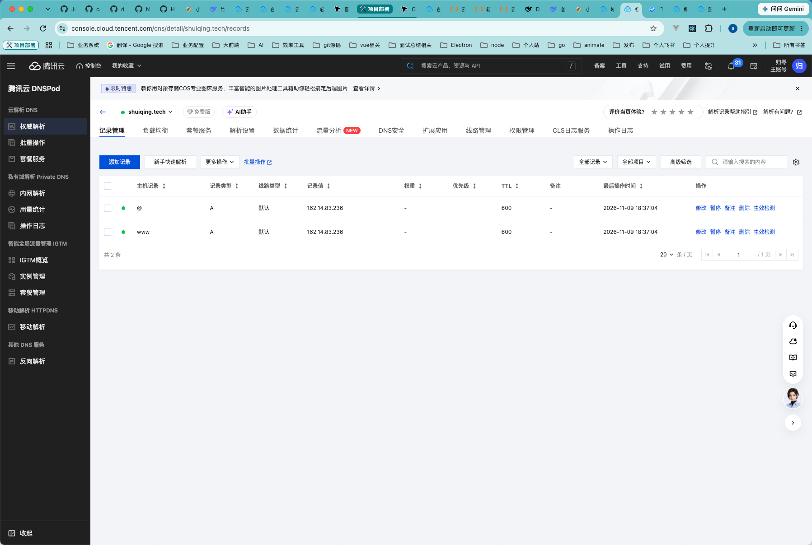

# 域名解析后仍不能访问：2026-11-09 排查记录

## 当前结论

域名 `shuiqing.tech` 和 `www.shuiqing.tech` 的 A 记录已指向 `162.14.83.236`。用户确认目前只完成域名实名认证，尚未完成 ICP 备案。服务器网关仍使用 IP 站点配置，域名的 HTTPS 入口尚未配置。本次只排查和记录，没有修改服务器或 DNS。

## 每一步在检查什么

1. **查询公共 DNS：确认域名是否找到正确服务器。** `dig @1.1.1.1 shuiqing.tech A` 与 `dig @223.5.5.5 shuiqing.tech A` 均返回 `162.14.83.236`；`www` 记录也返回该 IP。检查时间约为北京时间 2026-11-09 18:39—18:40。最初查询短暂没有结果，随后两个公共解析器已返回正确记录；个别客户端仍可能存在旧缓存。
2. **直接访问 IP：确认现有网站入口仍在运行。** `curl --noproxy '*' -I https://162.14.83.236` 返回 HTTP/2 401 和 Basic 登录认证要求，TLS 验证通过。401 在这里表示入口要求登录，不代表服务宕机。本次没有提交密码或验证登录后的业务功能。
3. **绕过 DNS 缓存测试域名：区分解析问题和网关问题。** `curl --noproxy '*' -I --resolve shuiqing.tech:443:162.14.83.236 https://shuiqing.tech` 返回 TLS alert internal error；`www` 结果相同。HTTP 访问返回 308 跳转到同域名 HTTPS，随后仍会遇到 TLS 问题。这证明单纯等待 DNS 缓存刷新还不足以完成域名接入。
4. **核对已部署配置的本地版本：确认网关绑定范围。** `deploy/tencent-public/Caddyfile` 仅声明 `https://162.14.83.236`，使用 IP 证书和 `default_sni`，未声明两个域名。此项为本地配置静态检查，未重新读取云端配置；线上域名 TLS 失败与该配置一致。
5. **确认 ICP 状态：判断正式域名开放的前置条件。** 用户确认尚未备案。腾讯云文档说明，域名指向中国内地服务器时，需要先完成网站备案；实名认证与 ICP 备案不同。

## 下一步及目的

1. 在腾讯云 ICP 备案入口提交备案资料，关联当前大陆服务器。身份证、核验信息由本人在官方页面填写，不发送到聊天。
2. 等备案通过并确认 DNS 仍指向当前公网 IP，再为网关增加两个域名及对应 HTTPS 证书；继续保留现有访问密码和数据目录。域名证书与当前 IP 证书分别配置。
3. 校验配置后重启网关，验证 HTTPS 证书、登录保护、登录后页面，并记录实际结果。修改网关不需要迁移或重新创建数据库。

在此之前，现有 IP 测试入口保持原状。尚未申请域名证书或重启网关，也未确认备案通过后的访问结果。

## DEBUG REPORT

- **Symptom:** 添加域名 A 记录后，域名仍无法打开短剧网站。
- **Root cause:** 公共解析现已生效，但域名 HTTPS 握手失败；已部署配置的本地版本只绑定 IP。用户另确认 ICP 备案未完成。
- **Fix:** none：本次完成诊断和操作文档，待用户完成备案后接入域名；未更改线上配置。
- **Evidence:** 两个公共 DNS 返回正确 IP；强制域名直连该 IP 的 HTTPS 测试失败；原 IP HTTPS 返回 401。
- **Regression test:** none：尚未实施修复。接入后需复测两个域名证书、登录保护和原 IP 入口。
- **Related:** [部署教程第 14 节](tencent-private-deployment.md#14-后续接域名)。
- **Status:** DONE_WITH_CONCERNS：诊断完成，域名仍未开通；备案及网关配置尚待完成。

官方说明：[腾讯云：域名无法访问网站](https://cloud.tencent.com/document/product/242/53667)、[腾讯云：解析生效相关](https://cloud.tencent.com/document/faq/302/30597)。
