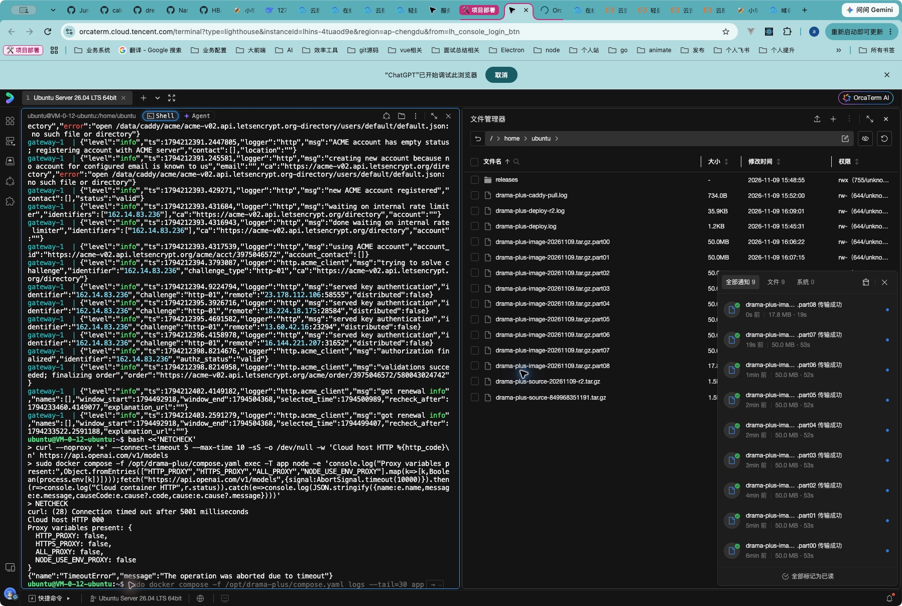

# OpenAI 云端接入排查（2026-11-09）

## DEBUG REPORT

- **Symptom：** 公网网站“测试配置”返回`fetch failed`，目标为`GET https://api.openai.com/v1/models`；另一台电脑同一地址测试成功。
- **Root cause：** 本次失败发生在云服务器到OpenAI的网络连接阶段。云主机curl无认证探测5秒连接超时，HTTP状态000；实际短剧容器内Node fetch无认证探测10秒超时。容器没有设置HTTP_PROXY、HTTPS_PROXY、ALL_PROXY或NODE_USE_ENV_PROXY。不能仅凭这些结果进一步断定具体是DNS、运营商链路还是目标侧阻断。
- **Fix：** 本次完成诊断，未修改应用、网络配置、Key或模型，也未部署代理。恢复调用需选择服务可达且符合地域要求的运行环境或模型服务；尚无已验证的恢复方案。
- **Evidence：** 用户提供的另一台电脑截图显示同一模型列表地址返回200；本机Mac无认证请求同一地址返回401，说明该机器可建立连接；云主机和实际容器的无认证连接均超时。无认证探测不验证用户Key是否有效，也不验证具体模型生成权限。
- **Regression test：** 无代码修改，因此没有新增单元测试。网络环境调整后，应在云主机与实际应用容器分别重跑以下只读探测，再由本人在网站中测试原配置。这里只读访问模型列表，不提交计费生成任务。
- **Status：** DONE_WITH_CONCERNS：诊断完成，调用尚未恢复；已有配置接口下发完整Key的问题也尚未修复。



## 为什么本地能用，部署后失败

“测试配置”由`backend/src/routes/aiConfigs.ts`调用服务端fetch，服务器负责连接模型接口，浏览器不会把电脑的网络环境自动带到云服务器。`joinProviderUrl`会为OpenAI补齐`/v1/models`，所以当前Base URL填写`https://api.openai.com`本身不是漏填`/v1`的问题。模型列表探测不使用配置的模型名，修改模型名不能解决本次连接超时。

后端完整网络异常会写入调用记录，界面目前只显示最外层`error.message`，所以详细的网络原因被简化成`fetch failed`。

## 无密钥复查命令

在服务器终端执行：

```bash
curl --noproxy '*' --connect-timeout 5 --max-time 10 -sS -o /dev/null -w 'Cloud host HTTP %{http_code}\n' https://api.openai.com/v1/models
```

没有携带Key时，若正常连接，通常会得到HTTP 401。401在这里仅说明能够到达HTTP服务，不代表Key校验成功。超时或HTTP 000说明尚未得到HTTP响应。

容器内检查实际Node运行环境：

```bash
sudo docker compose -f /opt/drama-plus/compose.yaml exec -T app node -e 'fetch("https://api.openai.com/v1/models",{signal:AbortSignal.timeout(10000)}).then(r=>console.log("HTTP",r.status)).catch(e=>console.log(JSON.stringify({name:e.name,message:e.message,causeCode:e.cause?.code})))'
```

## 开发者工具为什么能看到Key

首次在网页管理界面输入Key并测试或保存时，浏览器必须把Key提交给后端。开发者工具显示应用层请求内容；HTTPS在网络传输时加密，不能把这里可见的JSON等同于公网裸传。密码输入框的圆点只隐藏显示，不改变提交内容。

当前还有独立的产品设计缺陷：`withParsedFields`展开数据库整行，配置列表、详情及创建/更新响应包含完整`api_key`；前端设置组件据此回填输入框并再次提交。数据库保存的Key也是可直接使用的值，不是登录密码那样的不可逆摘要。拿到当前共享网站访问密码的人，能够使用并读取这些配置，不具备用户或管理权限隔离。

产品化应将模型Key保存在服务端，配置查询只返回`has_api_key`和掩码，已保存配置测试通过配置ID由后端读取Key；普通用户不能读写模型设置。需要明确的管理员权限、数据隔离与用量控制。Key供模型调用时需要恢复原值，不能像登录密码一样只存不可逆哈希。

以上为诊断与后续修复要求，**尚未实现这些权限和密钥管理变更**。

## 官方资料

- [OpenAI连接错误与认证错误的区别](https://developers.openai.com/api/docs/guides/error-codes)
- [OpenAI API支持地区](https://developers.openai.com/api/docs/supported-countries)：截至本次检查，中国大陆未列在支持地区中。是否有代理不是地域服务资格的替代证明。
