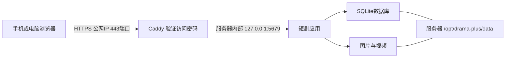
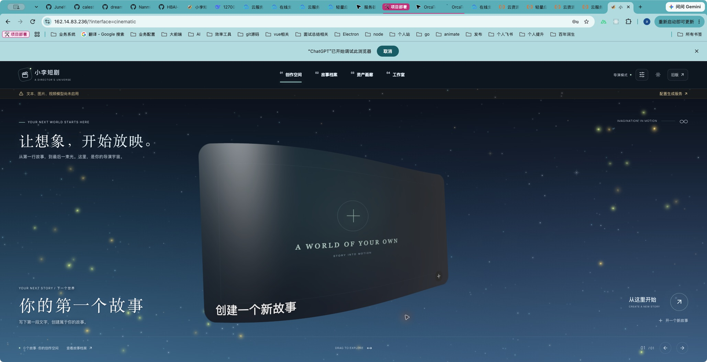
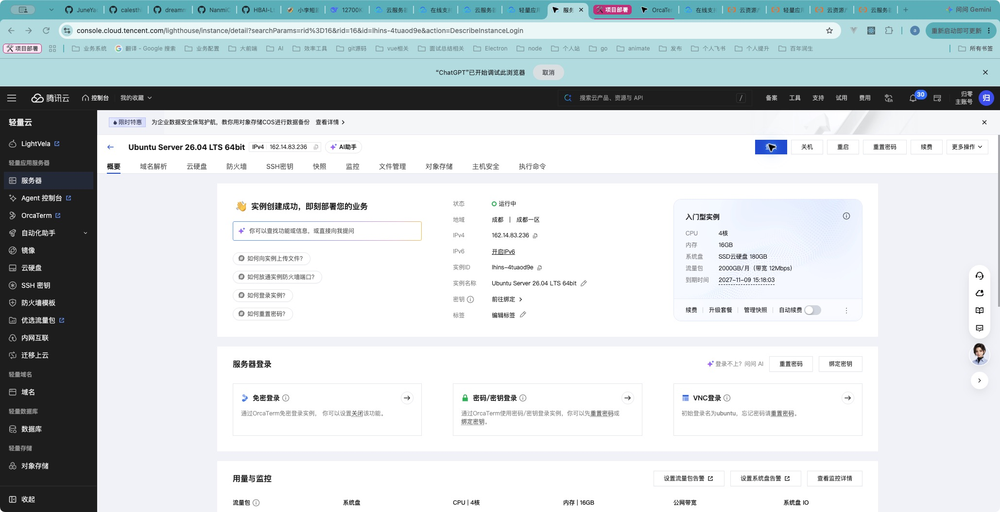
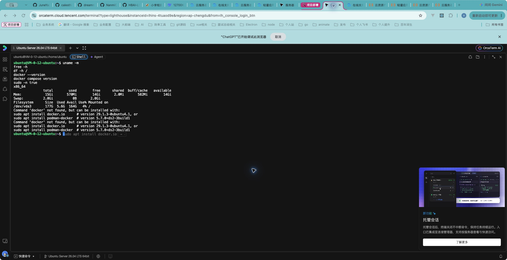
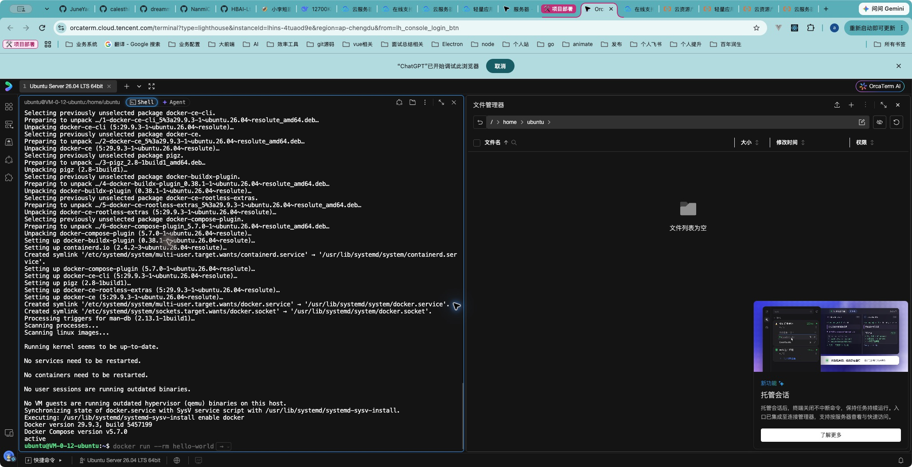
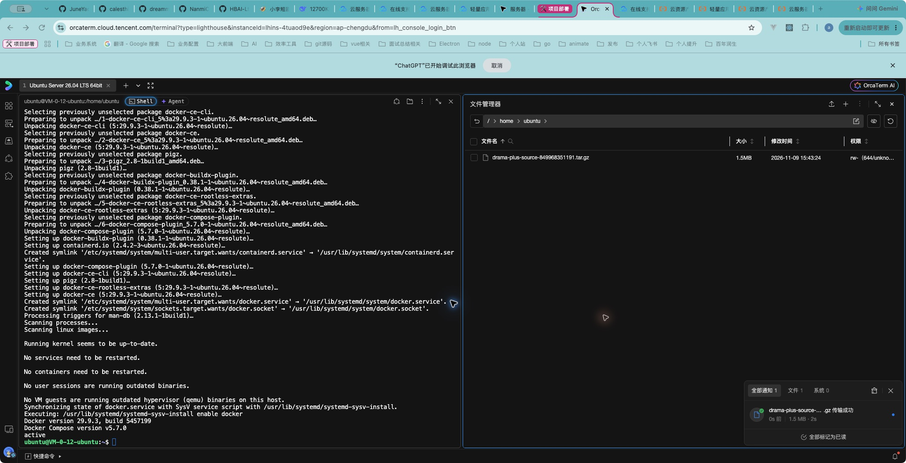
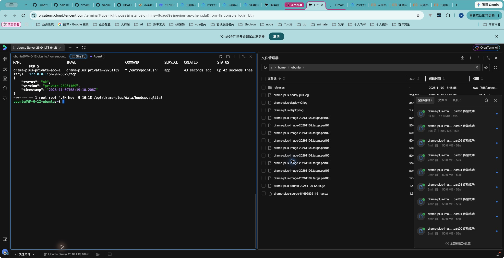
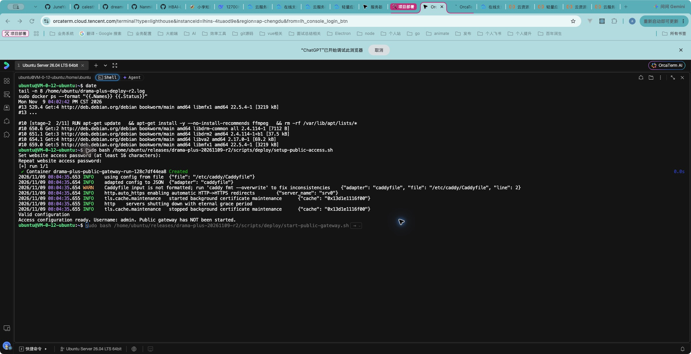
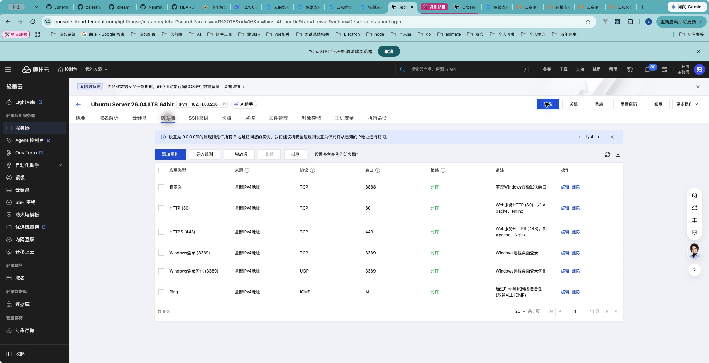

# 小李短剧 腾讯云公网IP部署教程

适用环境：腾讯云轻量应用服务器、Ubuntu Server 26.04 LTS、x86_64。本文将短剧部署为个人测试工具，通过公网IP的HTTPS地址访问，并设置访问密码。应用本身仍只绑定服务器本机5679端口，由Caddy网关转发请求。数据库与媒体文件保存在服务器磁盘；首次部署使用空数据库，本机已有项目、照片、视频和密钥不随源码上传。



公网IP是服务器的地址，端口区分服务器上的不同服务。Caddy相当于入口，验证密码并加密传输；短剧应用处理网页与业务；SQLite把结构化数据保存为磁盘文件，因此本次不用另买数据库服务。

## 本次部署结果（2026-11-09）

访问地址：**https://162.14.83.236**。用户名：**admin**。密码使用本人在服务器终端设置的密码，本文不记录密码。

- 已核对服务器：成都、4核16GB、180GB SSD、12Mbps、2000GB/月。
- 已通过腾讯云 OrcaTerm 的 TAT 免密连接登录 ubuntu 用户。
- 已检查：x86_64，约14GiB可用内存，根磁盘约164GB可用。
- 已安装：Docker 29.9.3、Compose v5.7.0，Docker服务为active。
- 已上传并校验源码包，配置腾讯云官方内网镜像加速。
- 本机Linux amd64容器的健康接口、SQLite驱动和FFmpeg检查通过。
- 已准备独立的私有部署 Compose 文件与打包、启动脚本。
- 本人已设置网站访问密码，Caddy配置校验通过。
- 云端依赖下载较慢，已停止重复构建，改用本机已验证镜像分片上传。
- 9个镜像分片均已上传成功、合并并通过SHA256校验；镜像已导入。
- 云端应用已启动且容器healthy，健康接口返回`ok`、版本`private-20261109`；已确认服务器上的SQLite文件存在。
- 本人已确认公网开放及Let's Encrypt证书协议，Caddy公网入口已启动，IP证书签发成功。
- 已从外网验证证书有效、HTTP自动跳转HTTPS、未登录及错误密码返回401；未登录API同样返回401，直接访问公网5679端口超时。
- 本人已在Chrome登录，公网短剧首页显示正常。尚未配置模型密钥、未执行付费生成。



## 1 登录服务器

**在哪里操作：** 腾讯云控制台的“轻量应用服务器 → 服务器 → 实例详情”。

**做什么：** 点击“登录”，在 OrcaTerm 中选择“免密连接 TAT”，用户名保持 ubuntu，点击登录。

**为什么做：** 打开服务器上的命令行。这里执行的命令操作云服务器，不是你的Mac。

**成功标志：** 页面显示“1个会话已连接”，终端出现 `ubuntu@...:~$` 提示符。

若终端看似有提示符，但普通命令和Ctrl+C均无响应，应从实例详情重新点击“登录”建立新连接，再用`date`确认命令有输出。不要把密码输入到没有响应的旧会话中。网页终端断线不会自动停止用`nohup`启动的后台构建。



## 2 检查服务器环境

在服务器终端逐条执行：

```bash
uname -m
free -h
df -h /
docker --version
docker compose version
```

**每条命令的作用：** `uname -m`查看CPU架构；`free -h`查看内存；`df -h /`查看磁盘剩余空间；最后两条确认Docker与Compose是否已安装。`docker: command not found`说明需要安装，不表示服务器损坏。



## 3 安装运行环境

源码包上传解压后，在服务器的源码根目录执行：

```bash
sudo bash scripts/deploy/install-docker.sh
```

脚本先刷新Ubuntu软件包列表、安装HTTPS下载工具，添加Docker官方签名公钥和apt软件源，再安装Docker与Compose，最后启用Docker服务。签名公钥用于验证软件包来源，软件源让后续可以通过apt更新。全程使用Docker官方Ubuntu安装方法，不执行第三方一键安装脚本。

**成功标志：** 输出Docker和Compose版本，最后一行为 `active`。本次实机为Docker 29.9.3、Compose v5.7.0。



Docker负责把应用与依赖装在统一的容器环境中；Compose负责保存端口、数据目录和自动重启配置。当前私有部署无需宝塔、MySQL、PostgreSQL或Redis，短剧使用SQLite。

## 4 在Mac上打包源码

**在哪里操作：** Mac终端。

```bash
cd /Users/jiwen/Documents/my/drama-plus
bash scripts/deploy/package-private.sh
```

**为什么做：** 生成可上传的源码压缩包。脚本只选取Git跟踪的应用文件及部署脚本，不包含本机数据库、生成媒体、环境文件和桌面安装包。新增源码应先加入Git跟踪，再重新打包；不必先推送GitHub。

**成功标志：** 输出压缩包路径及SHA256校验值。校验值用于检查上传前后文件是否一致。

## 5 上传与解压

在OrcaTerm点击终端右上角文件夹图标，打开文件管理器。确认远程目录为 `/home/ubuntu`，点击上传图标，再选择“上传文件”，选中步骤4的压缩包。看到“传输成功”后再解压。

本次使用 `drama-plus-source-20261109-r2.tar.gz`，执行：

```bash
mkdir -p /home/ubuntu/releases/drama-plus-20261109-r2
tar -xzf /home/ubuntu/drama-plus-source-20261109-r2.tar.gz -C /home/ubuntu/releases/drama-plus-20261109-r2
```

`mkdir -p`创建版本目录，`tar -xzf`解压源码。以后更新换一个新版本目录，避免覆盖旧版源码。上传后用 `sha256sum 文件名` 核对步骤4输出的校验值。



**为什么做：** 将程序从Mac复制到服务器，保留不同版本的源码以便更新和排错。已有业务数据不放在版本目录里。

## 6 构建与启动

在服务器解压后的源码根目录执行：

```bash
sudo bash scripts/deploy/start-private.sh private-20261109
```

**脚本做什么：** 构建前端静态网页；安装Node后端依赖和FFmpeg；生成有版本标签的应用镜像；创建 `/opt/drama-plus/data`；使用Compose启动容器；检查健康接口。

**成功标志：** 输出健康接口JSON和 `Private application is healthy`；`sudo docker compose -f /opt/drama-plus/compose.yaml ps`显示应用运行且健康。

首次构建需要下载基础镜像与依赖，所需时间取决于服务器网络。下载失败时先检查具体错误，不随意替换成来源不明的镜像。

### 备用方式：在Mac构建，再上传镜像

本次云端下载Debian依赖较慢，因此同时准备了本机已验证的Linux amd64镜像。Mac需先安装并启动Docker Desktop，在项目根目录执行：

```bash
docker build --platform linux/amd64 --build-arg HUOBAO_VERSION=private-20261109 -t drama-plus:private-20261109 .
docker save drama-plus:private-20261109 | gzip > /tmp/drama-plus-image-20261109.tar.gz
```

**每条命令的作用：** 第一条为服务器的x86_64架构构建应用；即使Mac使用Apple芯片，也要保留`--platform linux/amd64`。第二条把完整镜像导出并压缩，它包含运行依赖，服务器导入后无需重新联网安装这些依赖。不要把本机数据目录或`.env`添加到镜像中。

按步骤5的方法上传镜像文件到服务器。本次压缩包为438,066,307字节，SHA256为`96de46c0326a5e2fd6e0747c8223126f2c6eb71fc1f897c3ff4d11dc6e269268`。确认上传完成、校验一致后，在服务器执行：

```bash
sha256sum /home/ubuntu/drama-plus-image-20261109.tar.gz
sudo docker load -i /home/ubuntu/drama-plus-image-20261109.tar.gz
sudo mkdir -p /opt/drama-plus/data /opt/drama-plus/backups
sudo cp /home/ubuntu/releases/drama-plus-20261109-r2/deploy/tencent-private/compose.yaml /opt/drama-plus/compose.yaml
sudo sh -c 'umask 077; printf "DRAMA_IMAGE=drama-plus:private-20261109\n" > /opt/drama-plus/.env'
cd /opt/drama-plus
sudo docker compose up -d
curl --fail http://127.0.0.1:5679/api/v1/health
```

**为什么做：** `load`导入镜像；`mkdir`准备持久数据目录；`cp`复制运行配置；`.env`指定版本；`up -d`在后台启动；`curl`检查服务。首次部署可直接执行以上命令，已有部署更新前应先备份`.env`与数据库。不要同时运行源码构建启动和镜像导入启动，以免两个流程争用同一版本。

**大文件上传失败时：** 本次完整镜像通过网页上传时失败，改为50MiB一个分片。可在Mac使用Python3分割：

```python
from pathlib import Path
p = Path('/tmp/drama-plus-image-20261109.tar.gz')
with p.open('rb') as f:
    i = 0
    while chunk := f.read(50 * 1024 * 1024):
        p.with_name(p.name + f'.part{i:02d}').write_bytes(chunk)
        i += 1
```

上传全部`.part00`到`.part08`文件。全部显示成功后，在服务器合并，再核对上面的SHA256；确认一致才执行`docker load`：

```bash
cat /home/ubuntu/drama-plus-image-20261109.tar.gz.part[0-9][0-9] > /home/ubuntu/drama-plus-image-20261109.tar.gz
sha256sum /home/ubuntu/drama-plus-image-20261109.tar.gz
```

分片尾号必须完整且有序，缺一片或校验不一致时不要继续导入。分片只解决单次传输失败的问题，不改变镜像内容。

本次服务器导入并启动成功后的检查截图如下，端口为`127.0.0.1:5679`，状态为`healthy`，JSON中的`status`为`ok`，最后一行是服务器磁盘上的数据库文件：



## 7 设置公网IP入口与访问密码

**访问目标：** `https://162.14.83.236`。Caddy网关负责HTTPS和密码验证，再转发到短剧服务。

**为什么加密码：** 短剧当前没有自身登录验证。统一入口密码保护项目、设置页和API，适合个人测试；它不提供多人账户隔离。

**在哪里操作：** 服务器源码根目录，由本人执行：

```bash
sudo bash scripts/deploy/setup-public-access.sh
```

按提示输入两次至少16个字符的访问密码，终端不会回显；用户名为 `admin`。密码不出现在命令历史，只保存bcrypt摘要。不要把密码发到聊天中。脚本仅准备配置，不自动开放公网入口。

“16个字符”指密码总长度至少16位，每个英文字母、数字、符号算1位。输入时没有星号也正常。成功时会看到以下配置验证结果：



使用IP的HTTPS证书需要向Let's Encrypt申请shortlived证书，由Caddy自动续期。本人确认接受证书订阅协议与公网开放后，再执行：

```bash
cd /opt/drama-plus-public
sudo docker compose up -d
sudo docker compose logs --tail=50 gateway
```

**每条命令的作用：** 第一条进入网关目录；第二条启动网关和证书管理；第三条查看启动与证书日志。80端口用于验证和跳转，443用于加密访问，5679无需直接开放公网。

**防火墙检查：** 本次服务器已有TCP 80和443的全部IPv4放行规则，不需要“一键放通”全部端口。



**成功标志：** 外部浏览器打开HTTPS公网IP，证书无警告；未登录返回401，输入正确密码后进入首页。证书异常时先排查，不忽略浏览器安全警告。

**本次已完成：** 服务器启动网关后，Caddy通过HTTP-01验证申请到IP证书。Mac外网请求未使用`-k`跳过证书检查，HTTPS正常返回401；HTTP返回308并跳转HTTPS。本人在Chrome输入访问密码后成功进入首页。

以后在另一台电脑或手机浏览器输入完整地址`https://162.14.83.236`，登录框用户名填`admin`，密码填本人设置的密码。无需在地址后加`:5679`。有密码的人能访问同一套测试数据，请只向需要使用的人提供密码。

**首次使用：** 点击首页“配置生成服务”或“工作室”，配置自己的文本、图片、视频模型服务与API密钥，再创建第一个故事。本次没有复制Mac上的密钥，也没有发起付费生成。网站访问密码和模型API密钥是两种不同用途的凭据。

## 可选 通过SSH隧道访问

应用仅绑定服务器的 `127.0.0.1:5679`。需要先为自己的电脑配置正常SSH登录，再在Mac终端运行：

```bash
ssh -N -o ExitOnForwardFailure=yes -L 15679:127.0.0.1:5679 ubuntu@162.14.83.236
```

然后打开 `http://127.0.0.1:15679`。

**为什么做：** SSH把Mac的15679端口转发到服务器本机的5679端口。网页通过加密通道访问，应用本身无需公网端口或公开域名。终端保持打开，隧道才持续工作；停止时按Ctrl+C。

**成功标志：** 浏览器显示短剧首页。配置模型之前先检查空项目列表和设置页，不发起付费生成。

OrcaTerm的TAT免密连接不等于Mac已获得SSH登录权限。服务器密码/SSH密钥需由本人在腾讯云控制台设置；不要把密码或模型API密钥发到聊天中。若首次SSH连接提示主机指纹，应通过腾讯云免密终端核对服务器的SSH主机公钥指纹后接受。

## 8 数据保存在哪里

| 内容 | 服务器位置 | 作用 |
| --- | --- | --- |
| SQLite数据库 | `/opt/drama-plus/data/huobao.sqlite3` | 项目、剧本、任务、模型配置等 |
| 图片和视频 | `/opt/drama-plus/data/static` | 生成素材与成片 |
| 工作区 | `/opt/drama-plus/data/workspace` | 提示词与技能模板 |
| 部署配置 | `/opt/drama-plus/compose.yaml` | 端口与数据目录映射 |
| 当前镜像版本 | `/opt/drama-plus/.env` | 指定运行哪个应用版本 |
| 公网网关配置 | `/opt/drama-plus-public/Caddyfile` | HTTPS、访问密码与内部转发 |
| 访问密码摘要 | `/opt/drama-plus-public/access.caddy` | bcrypt摘要，不是明文密码 |
| 证书与续期状态 | `/opt/drama-plus-public/caddy-data` | Caddy自动管理证书的持久目录 |

容器内 `/app/data` 映射到服务器 `/opt/drama-plus/data`。替换容器不会自动清空这个目录；删除服务器磁盘或手动删除目录仍会丢失数据。数据库内可能保存模型密钥，备份同样需要保密。

## 9 日常查看与重启

以下命令在服务器上执行：

```bash
cd /opt/drama-plus
sudo docker compose ps
sudo docker compose logs --tail=100 app
sudo docker compose restart app
```

第一条检查运行状态；第二条查看最近日志；第三条重启应用。重启可能中断当前生成或视频合成，应在没有运行中任务时操作。分享日志前先检查是否含密钥、签名链接或用户内容。

公网入口的状态和日志单独查看：

```bash
cd /opt/drama-plus-public
sudo docker compose ps
sudo docker compose logs --tail=100 gateway
```

IP使用短有效期证书，Caddy已配置自动续期。保持网关运行、80和443端口可达，并保留`caddy-data`目录；不要每次更新应用时删除证书目录。当前只是完成首次签发与访问验证，未来续期结果仍需通过日志及证书有效期检查。

## 10 更新与回滚

更新前先备份，再重新打包上传源码，在新版本目录运行启动脚本并使用新版本标签，例如 `private-20261110`。启动脚本保留旧镜像，不会主动删除数据目录，并将前一个版本的环境文件保存为 `.env.previous`。

仅当新旧数据库结构兼容时，可这样切回上一个镜像：

```bash
cd /opt/drama-plus
sudo cp .env.previous .env
sudo docker compose up -d
curl --fail http://127.0.0.1:5679/api/v1/health
```

数据库结构有变化时，镜像回滚不等于数据回滚；应先核对该次版本说明，并保留升级前备份。

## 11 备份与恢复

最容易理解的完整备份方法是：等待生成/合成结束，停止应用，归档整个数据目录，再启动应用。以下在服务器执行：

```bash
cd /opt/drama-plus
sudo docker compose stop app
sudo install -d -m 700 backups
sudo sh -c 'umask 077; tar -czf "backups/data-$(date +%Y%m%d-%H%M%S).tar.gz" data'
sudo docker compose start app
```

**为什么先停止：** 避免复制时数据库仍有写入，或视频只保存了一半。整个data目录连同SQLite辅助文件一起备份。归档失败时也要重新启动应用。

备份后下载到自己的电脑或另一处独立存储，仅留在同一台服务器的备份无法防止整台服务器丢失。恢复时先停止应用、保留当前data目录，再从备份恢复；不要在不核对内容的情况下覆盖现有数据。

## 官方参考

- [Docker在Ubuntu上的安装说明](https://docs.docker.com/engine/install/ubuntu/)
- [腾讯云轻量应用服务器文档](https://cloud.tencent.com/document/product/1207)
- [腾讯云官方Docker镜像加速说明](https://cloud.tencent.com/document/practice/1207/45596)
- [Let's Encrypt IP证书说明](https://letsencrypt.org/2026/01/15/6day-and-ip-general-availability)
- [Caddy访问密码配置](https://caddyserver.com/docs/caddyfile/directives/basic_auth)

## 12 国内服务器拉取镜像超时

日志出现 `registry-1.docker.io` 访问超时时，在腾讯云服务器配置官方内网镜像源。先备份 `/etc/docker/daemon.json`，保留原有其他字段，再加入：

```json
{
  "registry-mirrors": ["https://mirror.ccs.tencentyun.com"]
}
```

随后执行：

```bash
sudo systemctl restart docker
sudo docker info --format '{{json .RegistryConfig.Mirrors}}'
```

**为什么做：** 通过腾讯云内网缓存下载Docker Hub镜像。重启Docker可能影响其他容器，本次操作时服务器没有运行中的业务容器。此内网地址仅用于腾讯云环境，不给Mac配置。

## 13 本次修复的构建问题

构建阶段改用系统FFmpeg，与运行镜像保持一致，避免npm安装时另从GitHub下载静态二进制。后端启动依赖tsx，已将其移入生产依赖，直接按锁文件安装，去掉删除后再联网补装的步骤；依赖版本没有变化。

## 14 后续接域名

2026-11-09 已注册域名后的实际检查、DNS 截图与待办见[域名访问排查记录](domain-connection-debug.md)。解析生效还需要网关接入域名，且当前大陆服务器的域名网站需要先完成 ICP 备案。

按腾讯云要求准备备案，再添加指向公网IP的A记录。编辑服务器`/opt/drama-plus-public/Caddyfile`，将站点地址从`https://162.14.83.236`改成`https://你的域名`，移除全局`default_sni 162.14.83.236`，保留密码验证和内部转发。域名可使用常规ACME证书配置，不必保留IP证书的`profile shortlived`。校验后重启网关：

```bash
cd /opt/drama-plus-public
sudo docker compose run --rm --no-deps gateway caddy validate --config /etc/caddy/Caddyfile
sudo docker compose restart gateway
```

Caddy会为域名申请证书，不需要搬迁SQLite和媒体文件。这里关闭了Caddy管理接口，因此采用重启；不要照抄依赖管理接口的`caddy reload`命令。

## 15 验证记录与使用范围

本机验证：后端类型检查通过，Nuxt静态构建通过，Linux amd64镜像构建通过。容器健康接口返回ok，SQLite自动创建20张表，FFmpeg和FFprobe可执行，公网入口配置通过Caddy校验。云端已导入同一镜像、创建持久化数据库，容器状态healthy、健康接口返回ok。

公网验证：HTTPS证书校验通过，HTTP跳转HTTPS，未认证首页、错误密码首页、未认证API均返回401，公网5679连接超时。本人通过Chrome登录，首页显示0个故事且模型尚未启用，符合首次部署的空数据库状态。未发起真实付费图片或视频生成；整条创作流程与多人并发容量尚未测试。

现有依赖审计仍有告警，其中proxy-addr被报告为critical。本次没有自动升级整套依赖。公网入口需要密码，正式开放多人使用前应处理依赖告警并补齐应用自身的登录与权限。

## 16 OpenAI连接失败与Key管理

本次后续排查确认：云主机与短剧容器直连`api.openai.com`均超时，本地成功不代表服务器出口可达。首次从管理页面提交Key时，开发者工具可看到应用层内容，实际网络由HTTPS加密；当前配置接口仍会返回完整Key，尚未具备产品级密钥管理和用户权限隔离。完整证据、复查命令和限制见[OpenAI云端接入排查](openai-cloud-connection-debug.md)。
